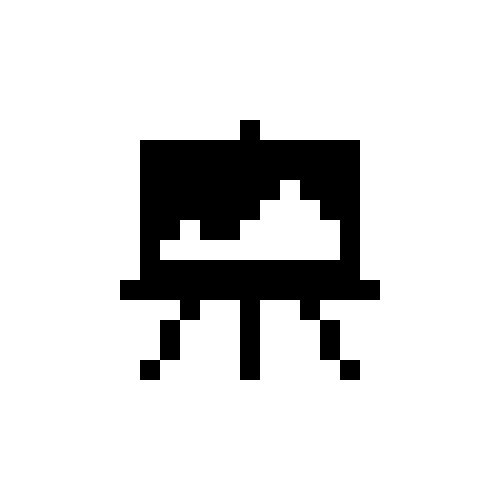
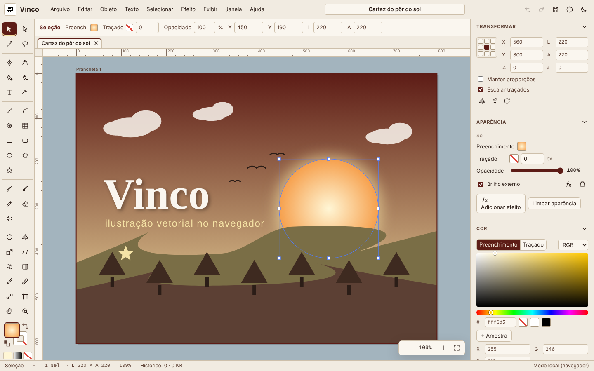
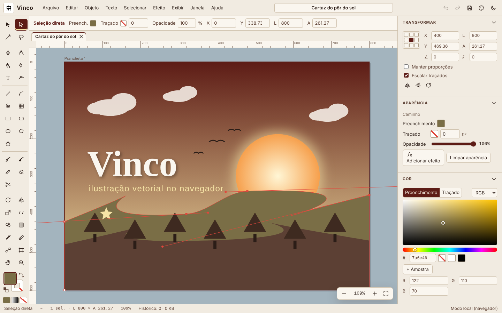
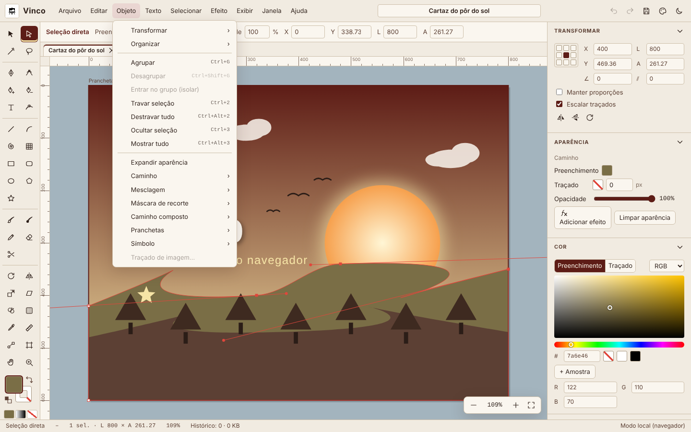
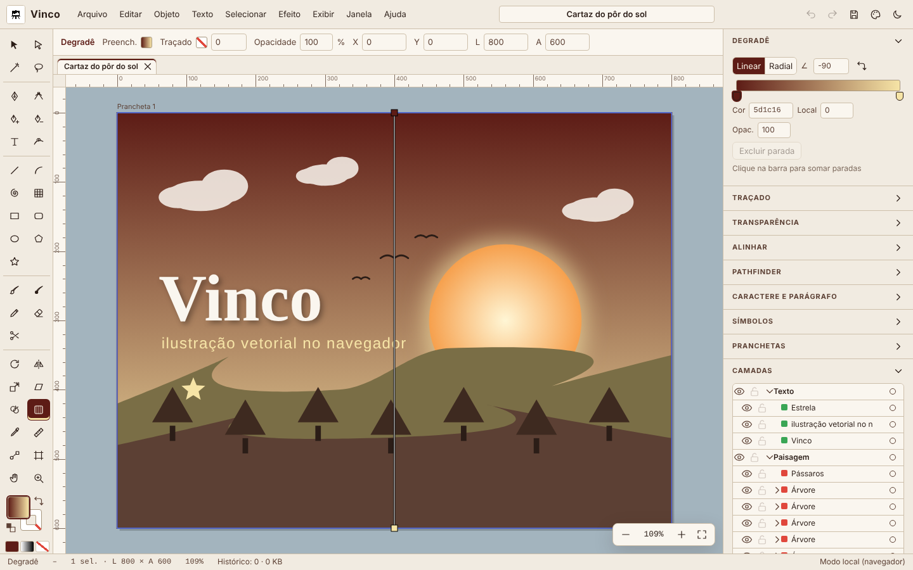
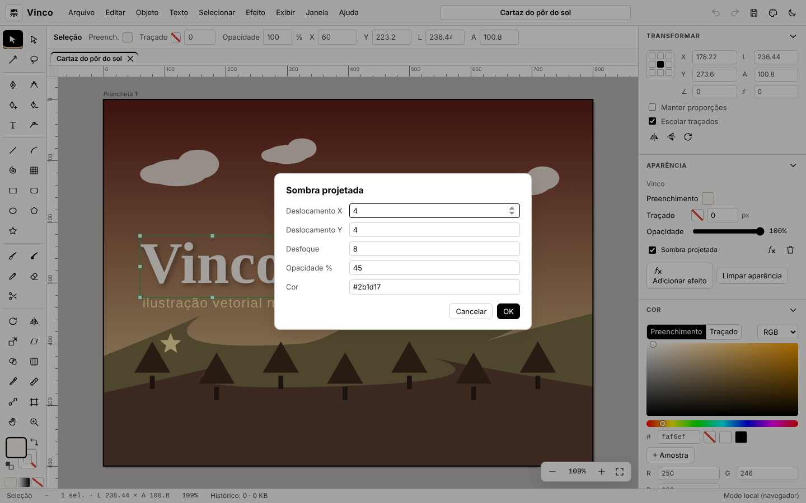
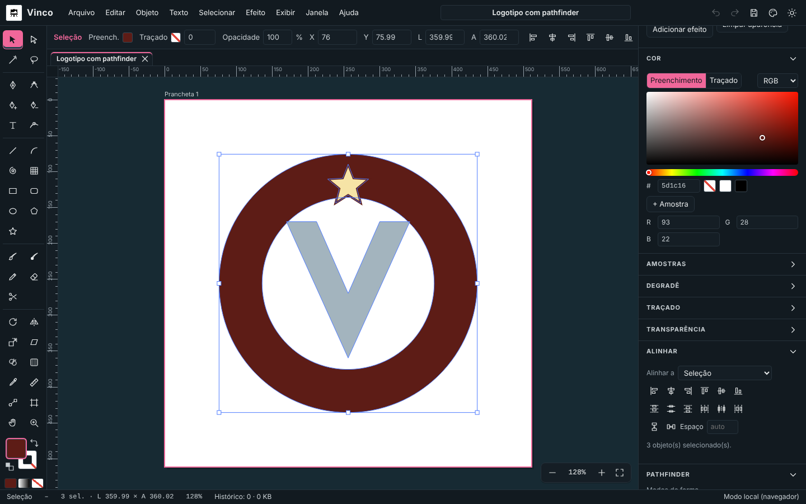
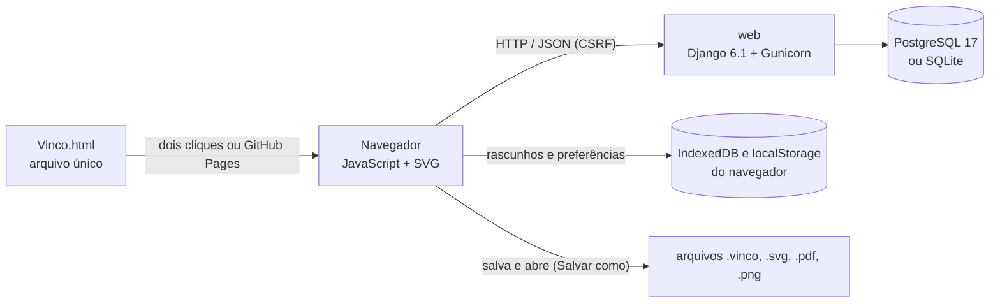

<p align="center">
  
</p>

<h1 align="center">Vinco<br><sub><sup><sup><sub>Copyright (©) 2026 Erik Pimenta</sub></sup></sup></sub></h1>

<p align="center">
  Editor de ilustração vetorial que roda no navegador, com o fluxo de trabalho de um programa profissional: caneta Bézier com seleção direta e ponto de ancoragem, formas, lápis, pincel, pincel de bolhas, borracha e tesoura, texto, texto em área e texto no caminho, Pathfinder completo, Construtor de formas, degradês lineares e radiais, efeitos, mesclagens, máscaras de recorte, caminhos compostos, símbolos, camadas, várias pranchetas, réguas, guias inteligentes e exportação em SVG, PDF com uma página por prancheta, PNG e JPEG.<br>
  Roda de duas maneiras: arquivo único no navegador (<code>Vinco.html</code>) ou servidor local com backend, banco de dados e histórico de versões.<br>
  Ou abra direto no navegador, sem baixar nada: <a href="https://easelwrights.github.io/Vinco-Vector-Illustration-Editor/">easelwrights.github.io/Vinco-Vector-Illustration-Editor</a>.<br>
  Pronto para baixar e usar.
</p>

<p align="center">
  JavaScript (módulos ES, SVG) · HTML5 · CSS3 · Python 3.13 · Django 6.1 · PostgreSQL 17 · Docker Compose · Node Test Runner · Playwright · Ruff · Bandit
</p>

---

> **Manual completo:** [`Manual-Vinco.pdf`](Manual-Vinco.pdf) explica as maneiras de rodar, a interface, cada uma das 36 ferramentas, os menus e os painéis, o Pathfinder e o Construtor de formas, degradês, efeitos, símbolos, camadas e pranchetas, exportação, o formato `.vinco`, a API, a configuração, a segurança, os testes e a solução de problemas, passo a passo (cópia em [`docs/`](docs/Manual-Vinco.pdf)).

> **Banco de dados:** [`Banco-de-Dados-Vinco.pdf`](Banco-de-Dados-Vinco.pdf) traz o diagrama de relacionamentos, as seis tabelas com campos, tipos, chaves e restrições, por que a árvore de objetos fica em JSONB dentro de cada camada, o controle de versões e de conflitos, a deduplicação das imagens, consultas prontas, índices, como preparar o PostgreSQL e as regras de integridade e segurança dos dados, além de sugestões para a arquitetura crescer (cópia em [`docs/`](docs/Banco-de-Dados-Vinco.pdf)).

> **Versão 1.0.0 (Atual):** primeira versão. Editor vetorial completo no navegador com 36 ferramentas, 9 menus, 13 painéis, abas para vários documentos, histórico de desfazer com limite de memória, rascunho automático, 4 paletas de interface com tema claro e escuro, exportação em SVG, PDF, PNG e JPEG, importação de SVG e de imagens, Traçado de imagem, backend em Django com PostgreSQL, API REST, versões dos documentos e publicação no GitHub Pages.

<p align="center">
  
</p>

## O que o Vinco faz

- **Caminhos Bézier de verdade:** cada objeto é um caminho com pontos de ancoragem e alças. A **Caneta** (P) cria pontos de canto com um clique e pontos suaves arrastando (Alt quebra a alça), fecha o caminho no primeiro ponto, continua um caminho aberto a partir da ponta e, sobre um caminho selecionado, soma ou tira pontos sozinha. **Adicionar** (+), **Excluir** (−) e **Ponto de ancoragem** (Shift+C) convertem canto em suave e vice-versa.
- **Seleção completa:** Seleção (V) com caixa delimitadora para mover, escalar (Shift mantém proporção, Alt escala a partir do centro) e girar pelos cantos; Seleção direta (A) para pontos, alças e segmentos; Varinha mágica (Y) por cor com tolerância; Laço (Q) para pontos; Alt+arrastar duplica; duplo clique num grupo entra no **modo de isolamento**.
- **Formas:** retângulo, retângulo arredondado, elipse, polígono, estrela, linha, arco, espiral e grade retangular. Arrastar desenha (Shift trava proporção e ângulos de 45°, Alt desenha a partir do centro) e um clique abre a janela com as medidas exatas.
- **Desenho à mão livre:** Lápis (N) e Pincel (B) com ajuste de curva (algoritmo de Schneider), Pincel de bolhas (Shift+B) que funde traços da mesma cor numa forma preenchida, Borracha (Shift+E) que recorta formas preenchidas e Tesoura (C) que corta caminhos no ponto clicado.
- **Transformação:** Girar (R), Refletir (O), Escala (S) e Distorcer com ponto de origem móvel, janelas numéricas com Copiar, **Transformar novamente** (Ctrl+D), painel Transformar com ponto de referência de 9 posições e unidades em px, pt, mm, cm ou in.
- **Pathfinder:** Unir, Menos frente, Interseção, Excluir sobreposição, Dividir, Aparar, Mesclar, Cortar demarcação, Contorno e Menos fundo. As operações recuperam as curvas do resultado, em vez de devolver polígonos cheios de pontos.
- **Construtor de formas** (Shift+M): passa o mouse sobre as regiões formadas pelas formas selecionadas, arrasta por várias para fundi-las e usa Alt para apagar uma região.
- **Cor e degradê:** seletor HSB com modos RGB, HSB e CMYK, amostras do documento, degradês lineares e radiais com paradas, opacidade e ângulo, ferramenta Degradê (G) para arrastar a direção, Conta-gotas (I) que copia a aparência, e os atalhos X, Shift+X, D, `/`, `,` e `.`.
- **Traçado:** espessura, pontas reta, arredondada e projetada, cantos pontudo, arredondado e chanfrado, limite do canto, linha tracejada com até três pares de traço e espaço e pontas de seta.
- **Aparência e efeitos:** opacidade, 16 modos de mesclagem, sombra projetada, desfoque gaussiano, brilho externo e interno, cantos arredondados, zigue-zague, áspero e franzir e inchar, todos editáveis depois no painel Aparência e transformados em geometria por **Expandir aparência**.
- **Objetos compostos:** grupos, máscaras de recorte (Ctrl+7), caminhos compostos com furos (Ctrl+8), mesclagens com etapas (Ctrl+Alt+B), Contornar traçado, Deslocar caminho, Simplificar, Unir (Ctrl+J), Média e Inverter direção.
- **Texto:** Texto (T) com clique para texto de ponto e arrasto para texto de área com quebra de linha, Texto no caminho, fonte, tamanho, peso, itálico, entrelinha, espaçamento e alinhamento à esquerda, ao centro, à direita ou justificado.
- **Símbolos:** transforma a seleção num símbolo reutilizável; cada instância acompanha o símbolo original e pode ter o vínculo quebrado.
- **Camadas e pranchetas:** camadas com cor, visibilidade e trava, árvore de objetos com arrastar e soltar, até 100 pranchetas por documento com a ferramenta Prancheta (Shift+O) e o painel Pranchetas, e Ajustar prancheta à arte.
- **Visualização:** zoom de 2% a 6400% no ponto do cursor, mão com Espaço, réguas com guias arrastáveis, grade e alinhamento à grade, **guias inteligentes** com medidas, modo Contorno (Ctrl+Y), tela cheia (F) e Tab para esconder os painéis.
- **Arquivos:** várias abas, formato `.vinco` com as imagens embutidas, Salvar como na pasta escolhida, importação de SVG (formas, caminhos, texto, grupos, transformações e degradês) e de PNG, JPEG, GIF e WebP, **Traçado de imagem** e exportação em SVG, PDF (todas as pranchetas, com degradês, texto e imagens), PNG com fundo transparente e JPEG em até 300 ppi.
- **Rascunho automático:** as alterações ficam guardadas no navegador (IndexedDB) enquanto você trabalha, e o Vinco oferece recuperá-las se a janela fechar.
- **Paletas de cores da interface:** o botão de paleta no topo alterna entre quatro paletas, cada uma com versão clara e escura. Detalhes em [Paletas de cores da interface](#paletas-de-cores-da-interface).
- **Seguro por padrão:** Content-Security-Policy restrita, CSRF, token de API comparado em tempo constante, limite de escritas por IP, validação de todo documento no editor e no servidor, imagens conferidas pela assinatura do arquivo e recusa de iniciar em produção com chave secreta fraca. Detalhes em [Qualidade e segurança](#qualidade-e-segurança).

<p align="center">
  
  
</p>

<p align="center">
  
  
</p>

## Paletas de cores da interface

O botão com o ícone de paleta, no canto superior direito ao lado do botão de tema, abre as quatro paletas da interface. A escolhida muda barras, painéis, menus e a área em volta das pranchetas e funciona junto com o tema claro ou escuro. As cores da sua arte não mudam.

| Paleta | Tema claro | Tema escuro |
| --- | --- | --- |
| **1** (padrão) | `#E6DDCE`, `#5D1C16`, `#A3B4BE`, `#F6E4A6` | fundo `#1D1613`, destaque `#F6E4A6` |
| **2** | `#F5F4F4`, `#FFFFFF`, `#000000`, `#3E6B2A`, `#9B2F1E` | fundo `#020202`, superfície `#121111`, destaque `#FFFFFF` |
| **3** | `#F3F1EC`, `#FCFBF8`, `#17212B`, `#E3ECEF`, `#A8235A` | fundo `#0F161B`, superfície `#172A33`, destaque `#F0679A` |
| **4** | `#E8E8E8`, `#D9D1CE`, `#BAB7B5`, `#AB9D9D`, `#000000` | fundo `#000000`, superfície `#121111`, destaque `#AB9D9D` |

A escolha fica salva neste navegador junto com as outras preferências. As paletas são variáveis CSS em `:root[data-palette]` no [`editor/static/editor/css/vinco.css`](editor/static/editor/css/vinco.css), e a lista do menu fica em `PALETTES` no [`editor/static/editor/js/main.js`](editor/static/editor/js/main.js).

<p align="center">
  
</p>

## Ferramentas e atalhos

| Ferramenta | Atalho | Ferramenta | Atalho |
|---|---|---|---|
| Seleção | V | Seleção direta | A |
| Varinha mágica | Y | Laço | Q |
| Caneta | P | Ponto de ancoragem | Shift+C |
| Adicionar ponto | + | Excluir ponto | − |
| Texto | T | Texto no caminho | — |
| Segmento de linha | \ | Arco, Espiral, Grade | — |
| Retângulo | M | Retângulo arredondado | — |
| Elipse | L | Polígono, Estrela | — |
| Pincel | B | Pincel de bolhas | Shift+B |
| Lápis | N | Borracha | Shift+E |
| Tesoura | C | Girar | R |
| Refletir | O | Escala | S |
| Distorcer | — | Construtor de formas | Shift+M |
| Degradê | G | Conta-gotas | I |
| Medida | — | Mesclagem | W |
| Prancheta | Shift+O | Mão / Zoom | H / Z |

Clicar duas vezes numa ferramenta abre as opções dela. Os atalhos dos menus seguem o padrão dos editores vetoriais: Ctrl+G agrupa, Ctrl+Shift+G desagrupa, Ctrl+F e Ctrl+B colam na frente e atrás, Ctrl+] e Ctrl+[ organizam, Ctrl+2 e Ctrl+3 travam e ocultam, Ctrl+7 cria a máscara de recorte, Ctrl+8 o caminho composto, Ctrl+J une, Ctrl+D transforma de novo, Ctrl+Y alterna o contorno, Ctrl+R as réguas, Ctrl+U as guias inteligentes e Ctrl+0 encaixa a prancheta. A lista completa fica em **Ajuda → Atalhos do teclado**. No navegador, alguns atalhos do próprio navegador (como Ctrl+N e Ctrl+W) têm preferência; por isso **Arquivo → Novo** também aceita Ctrl+Alt+N e **Fechar documento** usa Ctrl+Alt+W.

## Menus

| Menu | O que tem |
|---|---|
| **Arquivo** | Novo (com predefinições de papel, web e redes sociais), Abrir, Abrir do servidor, Salvar, Salvar como, Salvar no servidor, Versões salvas, Inserir imagem ou SVG, Exportar SVG, PDF, PNG e JPEG, Configurar documento e Fechar |
| **Editar** | Desfazer, Refazer, Recortar, Copiar, Colar, Colar na frente, Colar atrás, Colar no lugar, Limpar, Duplicar, Editar cores (inverter, tons de cinza e mesclar de frente para trás) e Preferências |
| **Objeto** | Transformar, Organizar, Agrupar, Desagrupar, Isolar, Travar, Ocultar, Expandir aparência, Caminho, Mesclagem, Máscara de recorte, Caminho composto, Pranchetas, Símbolo e Traçado de imagem |
| **Texto** | Caractere e parágrafo, Converter em texto de área ou de ponto, alinhamentos e tamanho da fonte |
| **Selecionar** | Tudo, Tudo na prancheta ativa, Desmarcar, Selecionar novamente, Inverter, Mesmo (preenchimento, traçado, espessura, opacidade, modo de mesclagem e tipo) e próximo objeto acima ou abaixo |
| **Efeito** | Aplicar último efeito, Estilizar, Desfoque e Distorcer e transformar |
| **Exibir** | Contorno, zoom, Caixa delimitadora, Réguas, Grade, Alinhar à grade, Guias inteligentes, Guias, Tela cheia e Tema escuro |
| **Janela** | Mostra ou esconde cada um dos 13 painéis |
| **Ajuda** | Tutorial rápido, Atalhos do teclado e Sobre |

## Arquitetura



| Parte | Linguagem | Responsabilidade |
|---|---|---|
| `editor/static/editor/js/core` | JavaScript | Núcleo sem DOM, testado no Node: geometria (matrizes afins, Bézier, limites exatos, achatamento, ponto mais próximo), caminhos (formas, leitura e escrita de `d`, arcos, divisão, união, ajuste de curva de Schneider, efeitos), operações booleanas (`boolean.js`), documento (`document.js`: camadas, grupos, organização, alinhamento, teste de clique, layout de texto), operações de alto nível (`ops.js`: Pathfinder, mesclagem, máscaras, símbolos, borracha, pincel de bolhas, traçado de imagem), SVG (`svg.js`: exportação e importação com analisador XML próprio), PDF (`pdf.js`), formato `.vinco` (`format.js`), histórico (`history.js`) e guias inteligentes (`snap.js`) |
| `editor/static/editor/js/ui` | JavaScript | Interface: aplicação e abas (`app.js`), visor em SVG com réguas, grade e sobreposições (`viewport.js`), as 36 ferramentas (`tools.js`), painéis (`panels.js`), menus e atalhos (`menus.js`), diálogos (`dialogs.js`), arquivos, rascunhos e API (`io.js`), ícones vetoriais (`icons.js`) e tutorial (`tutorial.js`) |
| `editor/static/editor/js/vendor` | JavaScript | `polygon-clipping` (operações booleanas robustas em polígonos), embutido como módulo |
| `Vinco.html` | HTML + JavaScript | O editor inteiro num arquivo só, gerado por `scripts/build-portable.js`: abre direto do disco e é o que vai para o GitHub Pages |
| `editor/` | Python (Django) | API REST, validação completa do documento, tabelas normalizadas, imagens deduplicadas por SHA-256, versões, conflitos, exportação SVG no servidor, cabeçalhos de segurança e limite de escritas |
| `postgres` | — | Fonte da verdade quando há servidor: documentos, pranchetas, camadas, símbolos, imagens e versões |

### Como o documento é guardado

Os objetos ficam no espaço do documento: um caminho guarda os pontos de ancoragem com as duas alças (`x`, `y`, `ix`, `iy`, `ox`, `oy`) e os subcaminhos, e transformar um caminho recalcula os pontos, como num editor vetorial. Texto, imagens e instâncias de símbolo guardam uma matriz afim. Degradês usam coordenadas relativas à caixa do objeto, então acompanham o objeto quando ele muda de tamanho. A tela e o SVG exportado saem da mesma função (`itemMarkup`), então o que você vê é o que é exportado.

### Como o histórico funciona

Cada ação guarda o estado do documento antes e depois, sem as imagens (que nunca mudam e ficam fora do histórico). Os gestos do mouse (arrastar, girar, desenhar) viram uma única entrada ao soltar o botão, e Esc cancela o gesto. O histórico guarda até 300 passos ou 96 MB, o que vier primeiro, e a barra de status mostra quanto ele ocupa.

## Como rodar

| Maneira | Como subir | Precisa de | Onde ficam os documentos |
|---|---|---|---|
| **1. Arquivo único** (`Vinco.html`) | Dois cliques no `Vinco.html`, ou o [GitHub Pages](https://easelwrights.github.io/Vinco-Vector-Illustration-Editor/) | Um navegador atual; nada para instalar | Arquivos `.vinco` na pasta que você escolher, e rascunhos no navegador |
| **2. Servidor local e backend** (Django + banco) | `start.cmd`, `./start.sh` ou `python manage.py runserver` | Docker Desktop, ou Python 3.12+ | No banco de dados (PostgreSQL ou SQLite), com versões e API |

### 1. Arquivo único (Vinco.html)

Baixe o repositório e abra o `Vinco.html` com dois cliques. Ele não precisa de internet nem de servidor. Para salvar, use **Ctrl+S**: no Chrome e no Edge abre a janela Salvar como; nos outros navegadores o arquivo `.vinco` vai para a pasta de downloads.

### 2. Servidor local e backend (editor + API + banco de dados)

#### Com Docker

```bash
./start.sh          # Linux e macOS
start.cmd           # Windows (dois cliques)
```

Na primeira vez, o script cria o `.env` com senha e chave aleatórias, sobe o PostgreSQL 17 e o Django com Gunicorn e abre [http://localhost:8080](http://localhost:8080). Os dados ficam no volume `vinco_dados-postgres`.

#### Sem Docker (Python)

```bash
python -m venv .venv
.venv/bin/pip install -r requirements.txt       # Windows: .venv\Scripts\pip install -r requirements.txt
python manage.py migrate
python manage.py runserver
```

Sem `VINCO_DB_ENGINE=postgresql`, o Django usa SQLite (`vinco.sqlite3`).

#### Só o editor, num servidor de arquivos (Node.js)

```bash
npm run serve       # http://localhost:5173, sem API
```

## Usando a API

```bash
# listar documentos
curl http://localhost:8080/api/v1/documents

# criar um documento a partir de um arquivo .vinco (com VINCO_API_TOKEN definido no .env)
curl -H "Authorization: Bearer $TOKEN" -H "Content-Type: application/json" \
     -d "{\"document\": $(cat examples/por-do-sol.vinco)}" http://localhost:8080/api/v1/documents

# SVG da prancheta 1 gerado no servidor
curl -o por-do-sol.svg "http://localhost:8080/api/v1/documents/<id>/svg?artboard=0"
```

| Rota | O que faz |
|---|---|
| `GET /api/v1` | Nome, versão e lista das rotas |
| `GET /api/v1/health` | Saúde do servidor e do banco (503 se o banco não responder) |
| `GET /api/v1/documents` | Lista os documentos (`q` filtra pelo nome) |
| `POST /api/v1/documents` | Cria um documento (`{"document": <.vinco>}`) |
| `GET/PUT/DELETE /api/v1/documents/{id}` | Abre, salva (com `revision` para detectar conflitos: 409 se outra aba salvou antes) e exclui |
| `GET /api/v1/documents/{id}/svg` | SVG de uma prancheta, gerado no servidor e servido com CSP `sandbox` |
| `GET /api/v1/documents/{id}/export` | Baixa o `.vinco` completo, com as imagens |
| `GET /api/v1/documents/{id}/versions` | Lista as versões guardadas |
| `POST /api/v1/documents/{id}/versions/{revision}/restore` | Restaura uma versão como uma nova revisão |

## Formato `.vinco`

É um JSON legível, salvo pelo **Ctrl+S** e aberto por **Arquivo → Abrir**:

```json
{
  "format": "vinco",
  "version": 1,
  "name": "Cartaz",
  "units": "px",
  "background": "#ffffff",
  "artboards": [{ "id": "a1", "name": "Prancheta 1", "x": 0, "y": 0, "width": 800, "height": 600 }],
  "layers": [{ "id": "l1", "type": "layer", "name": "Camada 1", "visible": true, "locked": false, "color": "#4f7cff", "children": [
    { "id": "p1", "type": "path", "fillRule": "nonzero", "opacity": 1, "blend": "normal", "effects": [],
      "subpaths": [{ "closed": true, "nodes": [{ "x": 0, "y": 0, "ix": 0, "iy": 0, "ox": 40, "oy": 0, "smooth": false }] }],
      "style": { "fill": { "type": "color", "color": "#5d1c16" }, "stroke": null, "strokeWidth": 0 } }
  ] }],
  "swatches": ["#000000", "#ffffff"],
  "symbols": [],
  "assets": { "as1": "data:image/png;base64,..." },
  "guides": { "horizontal": [], "vertical": [] }
}
```

Os tipos de objeto são `path`, `text`, `image`, `group` (com `clip` para máscaras) e `instance` (símbolo). A unidade interna é o ponto (1 px = 1 pt = 1/72 pol), a mesma do PDF; `units` só muda a forma de mostrar as medidas. Um arquivo com `version` maior que 1 foi salvo por um Vinco mais novo e é recusado.

A pasta [`examples/`](examples) tem dois documentos para abrir e estudar: o cartaz do pôr do sol com três camadas, degradês, nuvens unidas no Pathfinder, grupos e efeitos (`por-do-sol.vinco`) e um logotipo feito com Menos frente (`logotipo.vinco`).

## Configuração

| Variável | Padrão | O que faz |
|---|---|---|
| `VINCO_PORT` | `8080` | Porta no navegador |
| `VINCO_SECRET_KEY` | — | Chave do Django. Gerada pelos scripts; nunca publique a sua |
| `VINCO_ALLOWED_HOSTS` | `localhost,127.0.0.1` | Endereços pelos quais o Vinco é acessado |
| `VINCO_HTTPS` / `VINCO_CSRF_TRUSTED_ORIGINS` | `false` / vazio | Use atrás de um proxy com HTTPS |
| `VINCO_API_TOKEN` | vazio | Token para scripts alterarem dados pela API sem o cookie CSRF |
| `VINCO_MAX_REVISIONS` | `30` | Quantas versões de cada documento ficam guardadas |
| `VINCO_MAX_DOCUMENT_MB` | `48` | Tamanho máximo de um documento enviado à API (413 acima disso) |
| `VINCO_WRITE_LIMIT` | `120` | Alterações por minuto aceitas de cada IP na API (`0` desliga) |
| `VINCO_TRUSTED_PROXY` | `false` | Atrás de um proxy confiável, usa o último endereço de `X-Forwarded-For` como IP do cliente |
| `VINCO_HSTS_SECONDS` | `31536000` | Duração do HSTS quando `VINCO_HTTPS=true` |
| `VINCO_DB_NAME` / `VINCO_DB_USER` / `VINCO_DB_PASSWORD` | `vinco` / `vinco` / — | PostgreSQL |
| `VINCO_WORKERS` | `2` | Processos do Gunicorn |

## Banco de dados

| Tabela | Campos principais |
|---|---|
| `document` | `id` (UUID), `name`, `units`, `background`, `revision`, `swatches` e `guides` (JSON), `size_bytes`, `created_at`, `updated_at` |
| `artboard` | `document_id`, `key`, `position`, `name`, `x`, `y`, `width`, `height` (largura e altura positivas) |
| `layer` | `document_id`, `key`, `position`, `name`, `visible`, `locked`, `color`, `items` (árvore de objetos em JSONB), `item_count` |
| `symbol` | `document_id`, `key`, `position`, `name`, `items` |
| `asset` | `document_id`, `key`, `mime` (PNG, JPEG, GIF ou WebP), `sha256`, `size`, `data` (binário) |
| `document_version` | `document_id`, `revision`, `snapshot` (JSONB), `asset_keys`, `size_bytes`, `created_at` |

Os detalhes, o diagrama e as consultas estão no [`Banco-de-Dados-Vinco.pdf`](Banco-de-Dados-Vinco.pdf).

## Personalizando o Vinco

| Quero... | Onde |
|---|---|
| Mudar as cores da interface | Botão de paleta e botão de tema no topo |
| Ajustar deslocamento do teclado, grade, guias inteligentes e caixa delimitadora | **Editar → Preferências…** (Ctrl+K) |
| Trabalhar em mm, cm, pol ou pt | **Arquivo → Configurar documento…** |
| Ter minhas amostras | Painel Amostras (**Nova amostra** e **Do desenho**) |
| Configurar o servidor | Variáveis do `.env` (veja [Configuração](#configuração)) |

Alterar o código-fonte, criar versões modificadas ou reaproveitar partes do código em outros projetos não é permitido pela [licença](#licença).

## Desenvolvimento e testes

```bash
npm test                                   # 55 testes do núcleo em JavaScript (Node 20+)
python manage.py test editor               # 27 testes da API Django (funcionamento, validação e segurança)
python -m unittest discover -s tests/e2e   # 33 testes ponta a ponta no Chromium (Playwright): 16 no Vinco.html e 17 com o Django
npm run portable                           # gera o Vinco.html de novo a partir do código do editor
ruff check .                               # estilo, bugs prováveis e regras de segurança no Python
bandit -q -r editor vinco -x editor/tests  # análise de segurança do Python
```

Para o teste ponta a ponta, instale antes `pip install playwright` e `python -m playwright install chromium`.

O `Vinco.html` é gerado a partir de `editor/static/editor/` por `scripts/build-portable.js`, sem bibliotecas: os módulos viram um único script embutido, o CSS e o ícone vão junto e a página ganha uma Content-Security-Policy própria. Depois de mudar o editor, rode `npm run portable`; o CI confere se o arquivo está em dia (`npm run portable -- --check`) e o GitHub Pages publica o arquivo a cada push na `main`.

## Qualidade e segurança

Resultado da rodada de testes da versão 1.0.0: **115 testes do núcleo, da API e da interface, todos passando**, e nenhum problema apontado pelo Ruff, pelo Bandit e pelo `manage.py check --deploy`.

| Verificação | O que cobre | Resultado |
|---|---|---|
| Núcleo JavaScript (55) | Matrizes, Bézier, limites, achatamento, ponto mais próximo, regras de preenchimento, formas, leitura de todos os comandos de caminho SVG (inclusive arcos com bandeiras grudadas), divisão, união e inversão de caminhos, ajuste de curva, teste de clique, efeitos, as 10 operações do Pathfinder, furos com evenodd e nonzero, deslocar caminho, contornar traçado, grupos, organização, alinhamento e distribuição, transformações, máscaras, caminhos compostos, mesclagens, símbolos, tesoura, borracha, traçado de imagem, histórico, layout de texto, exportação e importação de SVG, analisador XML, formato `.vinco`, validação de conteúdo perigoso, estrutura do PDF (tabela xref conferida byte a byte) e conversões de cor | 55 de 55 |
| API Django (27) | Ciclo dos documentos, tabelas normalizadas, revisões e conflitos, versões e restauração, poda das versões, imagens deduplicadas, recusa de imagens com assinatura falsa e de SVG embutido, validação, JSON inválido, 404, busca, exportação SVG com texto escapado e CSP `sandbox`, CSRF, token de API, limite de escritas, cabeçalhos de segurança, métodos, limite de tamanho (413) e limpeza do nome da fonte | 27 de 27 |
| Interface (33) | O editor aberto no Chromium de dois jeitos, como `Vinco.html` direto do disco e contra o Django: retângulo e elipse, desfazer e refazer, caneta com curvas e fechamento, mover com o mouse e as setas, Alt+arrastar, Pathfinder, grupos e painel Camadas, texto, seleção direta, amostras, efeitos, exportação SVG, PDF e PNG, menus e atalhos, abas, paletas e tema, rascunho recuperado e, no servidor, salvar, salvar de novo e reabrir | 33 de 33 |
| Ruff e Bandit | Estilo, bugs prováveis e regras de segurança do Python | Sem problemas |
| `manage.py check --deploy` | Configuração de produção do Django com HTTPS | Sem erros |

| Camada | Proteção |
|---|---|
| Navegador | CSP `default-src 'self'` no servidor e, no `Vinco.html`, CSP própria que só executa o script embutido (conferido por hash SHA-256), sem conexões de rede (`connect-src 'none'`); todo texto do usuário é escapado antes de entrar no SVG ou na interface; nomes de fonte são limpos; imagens só entram como PNG, JPEG, GIF ou WebP em `data:`; o importador de SVG ignora `<script>`, `foreignObject`, links `javascript:` e imagens externas |
| API | CSRF com cookie `SameSite=Strict`, token Bearer comparado em tempo constante, limite de escritas por IP, validação completa do documento (tipos, limites, cores, matrizes, identificadores repetidos), imagens conferidas pela assinatura dos bytes, corpo limitado em tamanho, controle de concorrência por revisão e `select_for_update` |
| Servidor | Recusa iniciar com `VINCO_DEBUG=false` e chave fraca, HSTS e cookies seguros com `VINCO_HTTPS=true`, contêiner sem root, `X-Frame-Options: DENY`, `nosniff`, `Permissions-Policy` e `Cross-Origin-Opener-Policy` |

### Estrutura

```text
Vinco.html                  o editor inteiro num arquivo só, que abre sem servidor e vai para o GitHub Pages (gerado)
editor/                     aplicação Django (modelos, API, validação, serviços, exportação SVG, segurança)
  static/editor/            o editor: index.html, css/, img/ e js/
    js/core/                núcleo em JavaScript, sem DOM, testado no Node
    js/ui/                  interface: aplicação, visor, ferramentas, painéis, menus, diálogos, arquivos, ícones e tutorial
    js/vendor/              polygon-clipping (operações booleanas)
  migrations/               esquema do banco
  tests/                    testes da API, da validação e da segurança
vinco/                      configurações do projeto Django
tests/js/                   testes do núcleo em JavaScript
tests/e2e/                  testes ponta a ponta da interface (Playwright)
examples/                   documentos .vinco de exemplo
scripts/                    servidor estático em Node, gerador do Vinco.html e criação do .env no Windows
docs/                       manuais em PDF e imagens do README
.github/workflows/          CI (testes, Ruff, Bandit, check --deploy, Playwright, PostgreSQL e Docker) e publicação no GitHub Pages
```

### Componentes de terceiros

O Vinco depende de componentes com licenças próprias, que continuam valendo para cada um deles:

| Componente | Uso no projeto | Licença |
|---|---|---|
| [polygon-clipping](https://github.com/mfogel/polygon-clipping) 0.15.7 | Operações booleanas do Pathfinder, da borracha, do pincel de bolhas e do Construtor de formas (embutido no editor) | MIT |
| [splaytree](https://github.com/w8r/splay-tree) | Estrutura de dados usada pelo polygon-clipping (embutido) | MIT |
| [robust-predicates](https://github.com/mourner/robust-predicates) | Testes geométricos exatos usados pelo polygon-clipping (embutido) | Unlicense |
| [tslib](https://github.com/microsoft/tslib) | Funções auxiliares incluídas pelo splaytree (embutido) | Apache-2.0 |
| [Django](https://www.djangoproject.com/) | Back-end e API | BSD-3-Clause |
| [WhiteNoise](https://whitenoise.readthedocs.io/) | Entrega dos arquivos estáticos | MIT |
| [Gunicorn](https://gunicorn.org/) | Servidor de aplicação | MIT |
| [psycopg](https://www.psycopg.org/) | Driver do PostgreSQL | LGPL-3.0 |
| [Playwright](https://playwright.dev/python/) | Teste ponta a ponta (só no desenvolvimento) | Apache-2.0 |
| [Ruff](https://docs.astral.sh/ruff/) | Análise estática do Python (só no desenvolvimento) | MIT |
| [Bandit](https://bandit.readthedocs.io/) | Análise de segurança do Python (só no desenvolvimento) | Apache-2.0 |

Os textos das licenças dos componentes embutidos estão em [`editor/static/editor/js/vendor/LICENSES.txt`](editor/static/editor/js/vendor/LICENSES.txt). Os ícones da interface são vetoriais e desenhados no próprio código, e a interface usa as fontes do sistema. PostgreSQL roda como serviço externo via Docker e não é redistribuído neste repositório.

### Limitações conhecidas

O Vinco segue o fluxo de trabalho de um editor vetorial profissional, mas não reproduz tudo o que existe nesse tipo de programa. Ficaram de fora nesta versão: objetos 3D, malha de degradê, pintura dinâmica, grade de perspectiva, deformação de marionete, pincéis artísticos e de padrão, ferramenta de largura, criação de contornos a partir de texto (o navegador não dá acesso aos desenhos das letras), máscaras de opacidade, estilos gráficos, ações gravadas e gráficos. No PDF, filtros (sombra, desfoque e brilhos), pontas de seta e texto no caminho não são exportados, e o texto usa as fontes padrão do PDF (Helvetica, Times e Courier).

## Licença

Copyright (©) 2026 Erik Pimenta. Todos os direitos reservados.

O Vinco é distribuído sob uma [licença de uso](LICENSE) própria:

| Pode | Não pode |
|---|---|
| Baixar e usar de graça, como `Vinco.html`, GitHub Pages ou servidor local | Modificar o Vinco ou criar versões derivadas |
| Configurar pelo `.env` e pelas preferências do editor | Copiar o código, no todo ou em parte, para outros projetos |
| Usar como quiser o que você cria ou exporta, inclusive em trabalhos comerciais | Redistribuir, publicar ou vender o Vinco |

Para pedir uma autorização que a licença não dá, fale com o autor pelo [GitHub](https://github.com/ravelroot). O texto completo está em [`LICENSE`](LICENSE).
